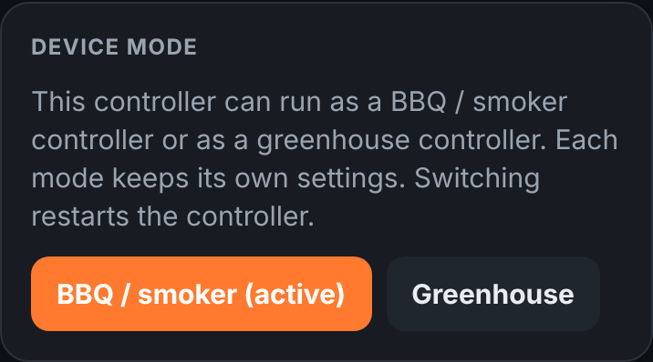
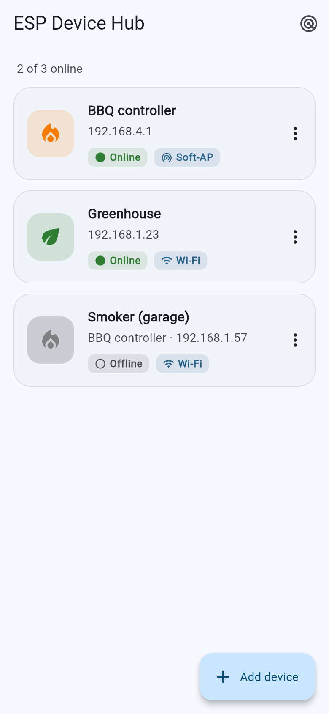
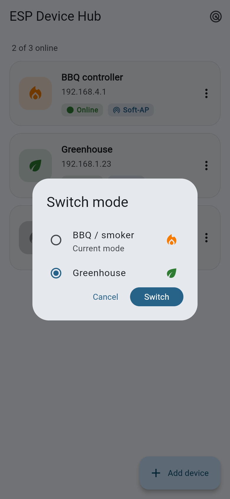

# DIY app engine: one ESP32, two controllers

One firmware for the Wemos D1 mini32 (ESP32) that runs either

- the **BBQ / smoker controller** ([BBQ-controller](https://github.com/Jory81/BBQ-controller)), or
- the **greenhouse controller** ([plant-controller2](https://github.com/Jory81/plant-controller2)).

Use greenhouse mode in spring and summer and BBQ mode in autumn and winter: each mode keeps its
own settings (targets, calibration, relay functions, light schedules, ...), so switching back
restores the values from last time. The two original projects stay standalone; this repository
is generated from them.



## Phone app: ESP Device Hub

[app/](app/) is an Android app (Flutter) that finds all your ESP32 devices — this firmware,
the single-mode BBQ controller and greenhouse — at home or on the `ESP32-AP` network
(192.168.4.1), remembers them and opens their page. For this firmware it also offers
*Switch mode*. Download the APK from the *Actions* tab (artifact `esp-device-hub-apk`); see
[app/README.md](app/README.md).

| Devices | Switch mode |
| --- | --- |
|  |  |

## Switching modes

- **Web page:** scroll to the bottom, *Device mode*, tap the other mode. The controller
  restarts (a few seconds) and the page reloads in the new mode.
- **Companion app / anything else:** `POST /mode` with `set=bbq` or `set=greenhouse`.
  `GET /mode` returns `{"mode":"bbq","modes":["bbq","greenhouse"],"restarting":false}`, and
  `/info` lists the modes too.

The first start after flashing over a single-mode firmware keeps that firmware's settings and
starts in its mode. A new board starts in BBQ mode.

## How it works

| | |
| --- | --- |
| `src/main.cpp` | reads the mode from flash and runs `bbq::setup()/loop()` or `greenhouse::setup()/loop()` |
| `src/common/mode.*` | mode storage, `/mode` routes, restart after switching, settings migration |
| `src/bbq/`, `src/greenhouse/` | the original firmwares, each wrapped in its own C++ namespace (**generated**) |
| `data/bbq/`, `data/gh/` | the two web pages (**generated**), served as `/` in their mode |
| `data/common/` | files both pages share (`ui.css`, `chart.js`, `alarm.mp3`) + `mode.js` (the switch) |

Only the active mode starts its hardware, web server and timers; the other mode's code is in
flash but doesn't run. Both modes together use 81 % of the 1.25 MB app partition and 15 % of
the RAM, with the standard partition table (so over-the-air updates keep working).

Each mode has its own settings store (`eeprom_bbq`, `eeprom_gh` in the ESP32's NVS), so
settings never mix.

## Updating from the original projects

Change the code in BBQ-controller or plant-controller2, then regenerate:

```
python3 tools/sync.py ../BBQ-controller ../plant-controller2
```

Never edit `src/bbq`, `src/greenhouse`, `data/bbq` or `data/gh` by hand. The script stops with
a message when the original code changed in a way it can't handle.

## Wiring both on one board

Only the active mode drives its pins, so you can swap hardware between the seasons. If you
build one board for both modes, mind the shared pins:

| GPIO | BBQ mode | Greenhouse mode |
| --- | --- | --- |
| 5, 26, 27, 32 | PT100 probes 1–4 (MAX31865 CS) | PT100 probes 1–4 (same) |
| 33 | PT100 probe 5 | relay 4 |
| 4 | fan PWM | fan 1 PWM |
| 2 | status LED | relay 5 |
| 21, 22 | OLED (I2C) | OLED + RTC (I2C) |

The PT100 boards and the fan can be shared; don't use BBQ probe 5 together with relay 4.

## Flashing

Ready-made binaries are in [firmware/](firmware/), including the way to move a greenhouse
controller to this firmware over wifi. Build yourself with PlatformIO:

```
pio run -e wemos_d1_mini32 -t upload      # firmware
pio run -e wemos_d1_mini32 -t uploadfs    # web pages (data/ folder)
```
