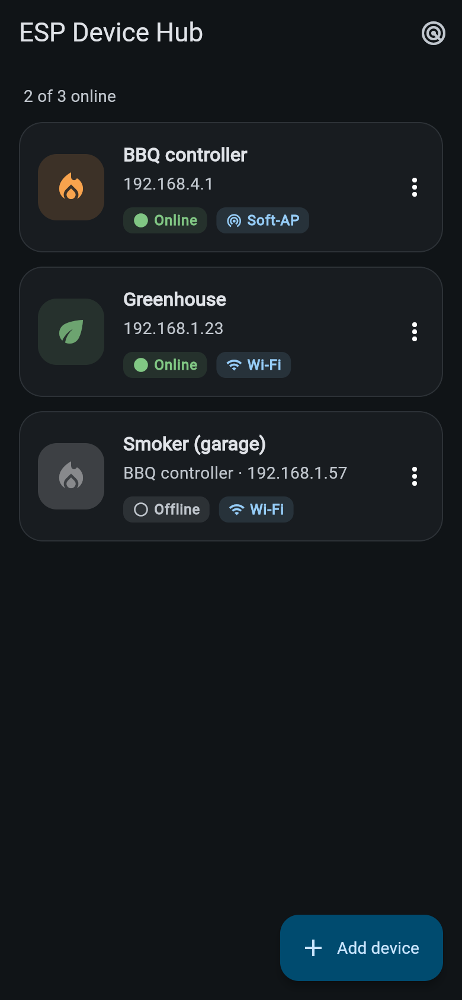
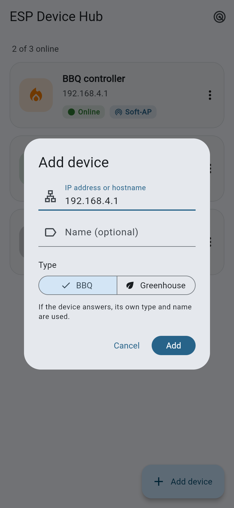
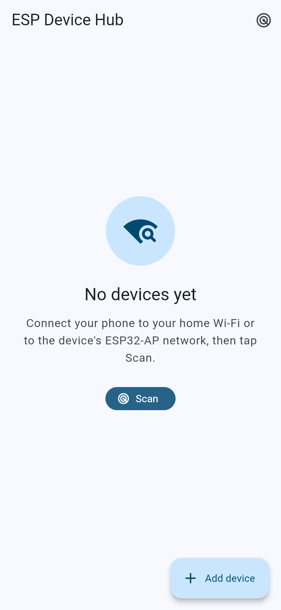
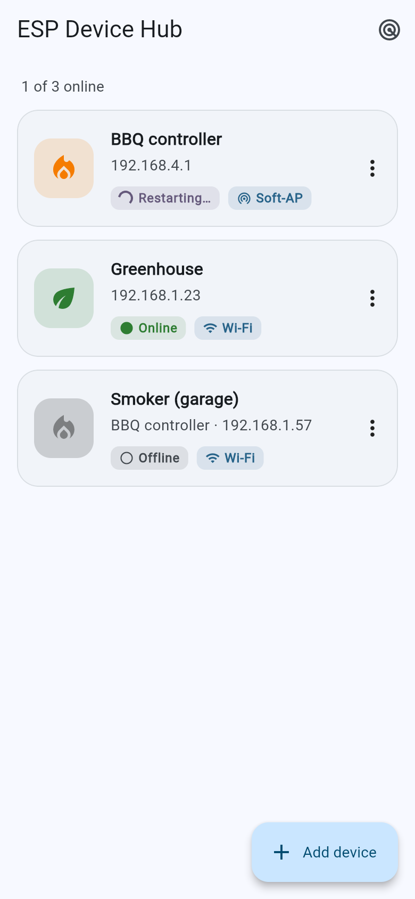

# ESP Device Hub (companion app)

A Flutter app for Android that **finds, remembers and opens** the DIY ESP32
devices of this repo: the BBQ controller, the greenhouse/plant controller and
any future device type that follows the same small contract (see below).

| Device list | Dark theme | Add device | Empty state |
|---|---|---|---|
|  |  |  |  |

| Switch mode | Restarting |
|---|---|
|  |  |

## What it does

* **Discovers devices automatically** when the app starts, on pull-to-refresh
  and with the Scan button (radar icon), both on the home Wi-Fi and on a
  device's own `ESP32-AP` soft-AP.
* **Remembers them** (shared_preferences): every device found is saved with
  its id, type, name, last-known IP and mode. You can rename, delete (with
  undo) or add devices by hand (IP/hostname + type BBQ or Greenhouse; if the
  device answers `/info`, its reported type wins).
* **Shows live status**: every saved device is polled (`/info`) every 10 s
  while the list is visible: Online/Offline, last-known IP and a mode badge
  (*Wi-Fi* = station mode, *Soft-AP* = the device's own access point).
* **Opens the device UI** full-screen in an in-app WebView: JavaScript on,
  audio without a user gesture (the BBQ alarm `alarm.mp3`), screen kept on
  while open, reload and *open in browser* buttons, back returns to the list.
  If the saved IP no longer answers, the app re-scans for the device's id
  (new DHCP lease, or it switched to soft-AP) before showing an error.
* **Switches multi-mode firmware** (one ESP32 that runs either BBQ or
  greenhouse): when `/info` lists more than one entry in `modes`, the card
  menu and the device page offer *Switch mode* (choice "BBQ / smoker" /
  "Greenhouse", then a confirm dialog). The app POSTs the new mode, shows
  *Restarting…*, polls `/info` every 2 s until the new `type` appears (up to
  60 s, then it re-discovers the device by id) and updates the saved entry's
  type and icon. The id, and therefore the saved entry and its custom name,
  stay the same across modes.
* Material 3, light and dark theme (follows the system). BBQ = orange flame,
  Greenhouse = green leaf, unknown types = grey chip icon with the raw type
  name.

## How discovery works

Three methods run **in parallel**; results are de-duplicated by device `id`
(`lib/src/discovery/discovery_service.dart`):

1. **mDNS**: browse `_espdevice._tcp` with Android's system NsdManager
   (package [`nsd`](https://pub.dev/packages/nsd)). It is more reliable on
   Android than raw multicast sockets, resolves TXT records and takes the
   Wi-Fi multicast lock itself (`CHANGE_WIFI_MULTICAST_STATE`). Each hit is
   confirmed with `/info` (to learn the mode); the TXT records are the
   fallback.
2. **Direct probes** of `http://192.168.4.1/info` (the ESP32 soft-AP), the
   Wi-Fi gateway's `/info` and the last-known address of every saved device.
3. **Subnet sweep** of the phone's /24 (`x.y.z.1`–`x.y.z.254`, ~700 ms
   connect timeout, max 32 requests at once) as a fallback for networks
   where multicast is blocked. A full sweep takes about 5 s.

Only hosts that answer `/info` with JSON containing an `id` count as devices,
so routers and other web servers are ignored. A device that moves (new IP,
or from Wi-Fi to soft-AP) is matched by its `id` and updated in place; your
custom name is kept.

## The Android soft-AP routing fix

When the phone joins a Wi-Fi **without internet** (the device's `ESP32-AP`)
while mobile data is on, Android keeps mobile data as the default network.
App traffic then goes out over mobile data and `192.168.4.1` is unreachable.

`android/app/src/main/kotlin/.../WifiNetworkBinder.kt` fixes this with
`ConnectivityManager.bindProcessToNetwork(wifiNetwork)`:

* At start it registers a `NetworkCallback` for `TRANSPORT_WIFI` (without
  requiring `NET_CAPABILITY_INTERNET`) and binds the **whole app process** to
  a Wi-Fi network **that has no internet** (the soft-AP). This covers Dart's
  HTTP sockets, mDNS and the WebView (its network stack runs in the app
  process), so the device UI and its websocket work on the soft-AP too.
* **Chosen behaviour: only bind while the Wi-Fi has no internet.** A Wi-Fi
  with internet (home Wi-Fi) is already Android's default network, so the app
  then connects like any other app and like the browser. Binding there anyway
  could pick the wrong network object (while switching networks, or a VPN
  running over Wi-Fi) and made every request fail while the browser worked.
  The choice is re-evaluated whenever a Wi-Fi appears, disappears or gets or
  loses internet, and before each scan. VPNs are never chosen.
* The same channel (`esp_device_hub/network`) returns the Wi-Fi IP, prefix
  and gateway from `LinkProperties` (fallback: `WifiManager.dhcpInfo`), so
  **no location permission** is needed.
* *Open in browser* starts another app, which is not covered by the binding:
  on the soft-AP with mobile data on, the browser may not reach the device.
  Use the in-app view there, or turn off mobile data.
* Some phones ask "This network has no internet access. Stay connected?"
  when joining `ESP32-AP`; answer *Yes* (optionally "don't ask again").

Permissions: `INTERNET`, `ACCESS_NETWORK_STATE`, `ACCESS_WIFI_STATE`,
`CHANGE_WIFI_MULTICAST_STATE`, `WAKE_LOCK`; `usesCleartextTraffic="true"`
because the devices speak plain HTTP.

## Device contract (firmware side)

Every device must provide:

* `GET http://<ip>/info` with header `Access-Control-Allow-Origin: *`:

  ```json
  {"type": "bbq", "name": "BBQ controller", "id": "a1b2c3",
   "version": "2.0", "mode": "ap", "ip": "192.168.4.1"}
  ```

  | field | meaning |
  |---|---|
  | `type` | `bbq`, `greenhouse`, … (unknown types are shown with a generic icon) |
  | `name` | default display name |
  | `id` | **required**, stable per device: last 3 MAC bytes as hex |
  | `version` | firmware version |
  | `mode` | `sta` (joined a Wi-Fi) or `ap` (own soft-AP) |
  | `ip` | the device's own IP, shown in the list |
  | `modes` | optional, multi-mode firmware only: e.g. `["bbq","greenhouse"]`; `type` is the active one |

* Multi-mode firmware only (`modes` present in `/info`):
  * `GET /mode` → `{"mode":"bbq","modes":["bbq","greenhouse"],"restarting":false}`
  * `POST /mode` with form body `set=greenhouse`
    (`application/x-www-form-urlencoded`) →
    `{"mode":"greenhouse","modes":[…],"restarting":true}`; the device restarts
    (~5–10 s), keeps its `id` and then reports the new `type` in `/info`.
* mDNS service `_espdevice._tcp` on port 80 with TXT records `type=`, `id=`,
  `name=`; hostname `bbq-<id>.local` / `greenhouse-<id>.local`.
* The web UI at `http://<ip>/` (it may use a websocket at `ws://<ip>/ws`).

## Build and install

### From GitHub Actions (no local tooling needed)

`.github/workflows/app.yml` runs on every push that touches
`app/**` and on *Run workflow* (workflow_dispatch). It analyzes,
tests and builds the release APK with Flutter 3.47.7 and Java 17, and
uploads it as the artifact **esp-device-hub-apk** (open the run on the
Actions tab, download the zip, unzip, copy the APK to the phone).

Pushing a tag `app-v*` (e.g. `git tag app-v1.0.0 && git push origin
app-v1.0.0`) also attaches the APK to a GitHub release of that name.

> The release APK is **signed with the Android debug key**, so it installs
> directly (allow "install unknown apps" for your file manager/browser).
> That is fine for personal use but not for the Play Store. An APK built on
> another machine has another debug key, so uninstall first if Android
> refuses the update ("package conflicts").

### Locally

Requires the Flutter SDK (3.47.x) and the Android SDK (Android Studio or
command-line tools), Java 17+.

```sh
cd app
flutter pub get
flutter analyze
flutter test
flutter build apk --release        # build/app/outputs/flutter-apk/app-release.apk
flutter install                    # or: adb install -r build/app/outputs/flutter-apk/app-release.apk
```

### Browser demo and screenshots

mDNS and the Kotlin channel do not exist on the web, so a browser build only
probes hosts directly. A demo build (`--dart-define=DEMO=true`, see
`lib/src/demo/demo.dart`; never active in normal builds) adds two mock
devices served by `tool/mock_devices.mjs` (the BBQ one is multi-mode and
really "reboots" on `POST /mode`) and one offline saved device:

```sh
flutter build web --no-web-resources-cdn --dart-define=DEMO=true -o build/web-demo
node tool/mock_devices.mjs build/web-demo     # app on http://localhost:8080
node tool/screenshots.mjs demo                # Playwright, writes screenshots/
```

## Code layout

```
lib/
  main.dart                      app + wiring
  src/device_hub.dart            state: saved devices, status poll, scan, locate
  src/models/                    DeviceInfo (/info parsing), Device, DeviceStore
  src/discovery/                 DiscoveryService, mDNS browser, subnet sweep,
                                 merge/de-duplication, concurrency helper
  src/net/                       InfoClient (/info over HTTP), NetworkBinding
  src/ui/                        home page, device card, dialogs, WebView page
  src/demo/                      demo-only seed data (DEMO=true)
android/app/src/main/kotlin/…    MainActivity + WifiNetworkBinder (soft-AP fix)
test/                            unit + widget tests
tool/                            mock devices + screenshot script
```
